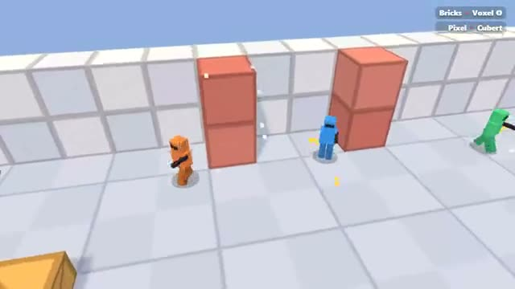

# Blocky Deathmatch

A first-person arena made of plain blocks. A multiplayer starter game from [Multiplayer Agent](https://multiplayeragent.com): 3D, versus, 2–8 players, with bots that fill empty seats.

## How it plays

Run, jump and shoot in a small block arena. Climb the crates to the middle platform, grab health packs that come back on a timer, and be first to 15 frags.

**Controls:** WASD and mouse, click to shoot, Space to jump. On a phone: left thumb moves, drag to look, FIRE shoots.

## Make it yours in the Game Builder

Open the [Game Builder](https://multiplayeragent.com), choose **Start from a starter game** and pick Blocky Deathmatch. It opens as version 1 in your studio, ready to play and publish. Then ask for changes, for example:

- Add a rocket launcher with splash damage
- Set the arena on a moving train
- Add a capture-the-flag mode

## Run it yourself

1. Get a free publishable key (`pk_…`) at [multiplayeragent.com](https://multiplayeragent.com).
2. In `index.html`, put it in place of `pk_REPLACE_ME` in the `MP_CONNECT` block.
3. Serve the folder (for example `npx serve`) and open it. The 3D engine loads as a module, which browsers block from a file on disk.

Without a key it still runs, offline against bots.

## How it is built

- One `index.html` plus three.js in `libs/`. The comment at the top of the script maps the code and explains the multiplayer. The arena is the `MAP` text block in `CONFIG`: edit the characters to change it.
- **Leaderboard:** The most frags anyone has scored in one match.
- **Host-run rounds:** One player's browser keeps the frags, the timer and the winner; if it leaves, the next player takes over.
- **Bots:** Bots run, aim and shoot until enough people join.
- **Live sync:** Every player moves and shoots for everyone at once. Each shot is decided by the shooter's browser, so what you hit on your screen counts.
- `?attract` runs it offline with bots only and a flying camera. The preview video is recorded from it.

## License

MIT. three.js in `libs/` is MIT too (Copyright 2010-2024 three.js authors).
